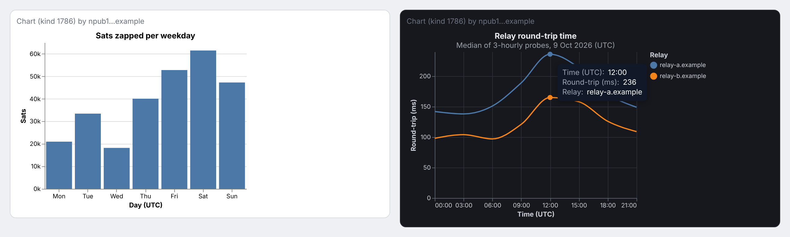

# Interactive Charts for Nostr (`kind:1786`)

A draft NIP for publishing interactive charts as Nostr events, with the files that support it.

A chart is a `kind:1786` event. Its content is a declarative chart in `vega-lite-nostr`, a closed, code-free subset of [Vega-Lite](https://vega.github.io/vega-lite/). Notes embed a chart the way they quote any other event: a `nostr:nevent1…` reference plus a `q` tag. Clients check the chart against an allow-list and draw it without running author code or making network requests. An `alt` tag carries a text description for screen readers and for clients that don't support charts.

**Status:** draft, not yet submitted to [nostr-protocol/nips](https://github.com/nostr-protocol/nips). Feedback is welcome in Issues.



## Contents

| Path | What it is |
|---|---|
| [`XX.md`](XX.md) | The NIP draft |
| [`vega-lite-nostr-1.schema.json`](vega-lite-nostr-1.schema.json) | JSON Schema (draft-07) for the dialect's property rules. Non-normative: the NIP is authoritative. |
| [`tools/chartcheck.py`](tools/chartcheck.py) | Reference validator. Checks the I-JSON rules, the size limit, the schema and the NIP's additional constraints. |
| [`tests/run_cases.py`](tests/run_cases.py) | Accept and reject cases for the validator. Many reproduce a known Vega or Vega-Lite problem that a rule exists to prevent. |
| [`examples/`](examples/) | The NIP's two example charts (`bar.json`, `line.json`), the signed example events (`events.jsonl`) and a screenshot of them rendered |

## Check a chart

You need Python 3 and the `jsonschema` package. On Arch-based systems, install it with `sudo pacman -S python-jsonschema`. Elsewhere, use `pip install jsonschema`.

Check events, or a bare chart document before you sign it:

```
python3 tools/chartcheck.py examples/events.jsonl
python3 tools/chartcheck.py examples/line.json
```

Run the test cases:

```
python3 tests/run_cases.py
```

The validator does not check signatures; use your usual Nostr library for that. The example events are signed with a throwaway key whose secret is public, so don't reuse it.
